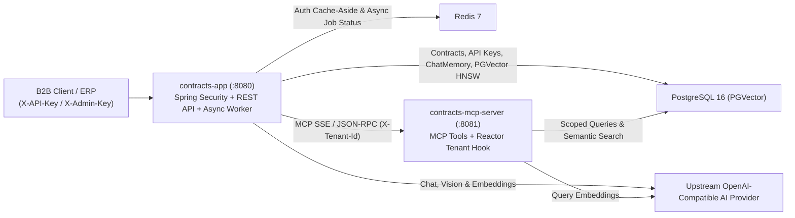

# Smart Home Contracts & Operations AI Platform


A multi-tenant B2B AI engineering, quotation, and operations platform for smart home integrators. It ingests bilingual Arabic/English contracts, scanned quotations, spreadsheets, and site survey notes; normalizes Bills of Materials (BoMs) against a tenant-isolated vector device catalog; enforces deterministic financial and Egyptian field-wiring guardrails; exposes an Operations Copilot over the Model Context Protocol (MCP); and exports client-ready Excel (`.xlsx`) quotations.

---

## System Architecture



---

## Core Architectural & Engineering Highlights

### 1. Multi-Module Maven Architecture
- **`contracts-domain`**: Pure Java 21 domain records, enums, deterministic `QuotationPricingCalculator`, and idempotent `FinancialGuardrailValidator` with zero Spring or persistence dependencies.
- **`contracts-ai`**: Spring AI structured extraction (`BeanOutputConverter`), smart document ingestion router (digital/scanned PDF rendering via PDFBox, Excel table extraction via Apache POI, image vision analysis), L2-normalized embedding service, multi-query quotation agent, and `TenantIsolationAdvisor`.
- **`contracts-persistence`**: Flyway migrations (`V1`–`V4`), PostgreSQL JPA entities (`contracts`, `extracted_data`, `device_catalog`, `tenant_api_keys`), Hibernate JSONB mapping, and native PGVector HNSW cosine-similarity JDBC queries.
- **`contracts-app`**: Stateless Spring Security API gateway, Redis cache-aside auth, `@Async` ingestion worker, Human-in-the-Loop (`/clarify`, `/approve`) workflow, semantic catalog APIs, Apache POI `.xlsx` exporter, and Operations Copilot REST controller.
- **`contracts-mcp-server`**: Decoupled Spring AI MCP WebMVC SSE server exposing tenant-isolated `@Tool` endpoints (`getClientProjectSummary`, `getPendingInstallments`, `aggregateProcurementBom`, `searchCompanyCatalog`).

### 2. Multimodal Ingestion, Deterministic Math Guardrails & `.xlsx` Export
- Routes `.xlsx`/`.xls`, digital or scanned `.pdf` (150 DPI memory-bounded page rendering), and images through specialized extraction paths to minimize token usage.
- Enforces deterministic `BigDecimal` math validation across line totals, installation fees, discounts, **14% Egyptian VAT**, and payment installment schedules (`50/30/20`, etc.), completely preventing LLM arithmetic or unit-price hallucination.
- Flags field-engineering risks (e.g., `WITH_NEUTRAL` vs `NO_NEUTRAL` switches in Egyptian Magic wall boxes, missing Zigbee hubs or amplifiers, FX linkage) and supports **Human-in-the-Loop (HITL)** refinement before approval and styled `.xlsx` quotation export (`GET /api/v1/contracts/extract/{extractionId}/export/xlsx`).

### 3. Cross-Lingual Semantic Catalog RAG (`PGVector`)
- Embeds device catalog entries and site-survey requirements into `1024`-dimension L2-normalized vectors stored in PostgreSQL `pgvector` with an HNSW cosine-distance (`<=>`) index.
- Grounds AI-generated quotations strictly against tenant-scoped catalog candidates, preserves `"TBD"` pricing + warnings for uncatalogued items, and performs **Price Drift Auditing** when contracted prices diverge from catalog reference prices.

### 4. Decoupled MCP Operations Copilot & Persistent `JDBC ChatMemory`
- Connects `contracts-app` to `contracts-mcp-server` over SSE/HTTP while enforcing a strict ordered advisor chain (`TenantIsolationAdvisor` -> `MessageChatMemoryAdvisor` -> `SimpleLoggerAdvisor`).
- Namespaces Spring AI `JdbcChatMemoryRepository` keys (`<tenantId>:<conversationId>`) inside a bounded sliding message window (`maxMessages = 12`).
- Preserves tenant isolation on `contracts-mcp-server` across Reactor `Schedulers.boundedElastic()` worker thread hops via `Schedulers.onScheduleHook(...)` (`McpReactorTenantContextConfig`) paired with `McpTenantFilter`.

### 5. Stateless `X-API-Key` Multi-Tenant Security
- Replaces untrusted client `X-Tenant-Id` headers with stateless Spring Security `X-API-Key` authentication backed by `tenant_api_keys` (`Flyway V4`) and `X-Admin-Key` constant-time verification for key issuance/revocation (`/api/v1/admin/api-keys`).
- Hashes keys with **SHA-256** (raw keys are returned once at issuance and never persisted) and accelerates lookups with **Redis Cache-Aside** (`5m` positive TTL, `60s` `"__INVALID__"` negative caching against DB cache-penetration floods, immediate eviction on revocation).

---

## Quick Start & Verification Guide

### Prerequisites
- Java 21 (JDK 21) and Apache Maven 3.9+
- Docker & Docker Compose (for local PostgreSQL/Redis, Testcontainers, and multi-stage image builds)

### 1. Configure Environment
```bash
cp .env.example .env
```
Edit `.env` with your upstream OpenAI-compatible `AI_BASE_URL`, `AI_API_KEY`, model settings (`AI_CHAT_MODEL`, `AI_VISION_MODEL`, `AI_EMBEDDING_MODEL`), and a strong `APP_ADMIN_KEY`.

### 2. Launch the Stack

#### Option A — Full-Stack One-Command Docker Compose Launch
Builds and starts all 4 containers (`postgres`, `redis`, `contracts-app`, and `contracts-mcp-server`) with healthcheck-ordered startup (`contracts-app` completes Flyway `V1`–`V4` migrations before `contracts-mcp-server` validates the schema), while overriding `localhost` endpoints automatically on `smart-home-net`:

```bash
docker compose up -d --build
```

#### Option B — Hybrid Local Development (Infra in Docker + Maven Apps)
Start only PostgreSQL and Redis in Docker, then run both Spring Boot services locally:

```bash
docker compose up -d postgres redis
mvn clean install -DskipTests

# Terminal 1: Start decoupled MCP operations server (port 8081)
mvn -pl contracts-mcp-server spring-boot:run

# Terminal 2: Start main API server (port 8080)
mvn -pl contracts-app spring-boot:run
```

### 3. Sample `curl` Workflows

1. **Issue a Tenant API Key (Admin):**
   ```bash
   curl -s -X POST http://localhost:8080/api/v1/admin/api-keys \
     -H "Content-Type: application/json" \
     -H "X-Admin-Key: <your-admin-key>" \
     -d '{"tenantId":"smart-power","keyName":"erp-client"}'
   ```

2. **Upsert Catalog Item (`X-API-Key`):**
   ```bash
   curl -s -X POST http://localhost:8080/api/v1/catalog/items \
     -H "Content-Type: application/json" \
     -H "X-API-Key: <your-tenant-api-key>" \
     -d '[{"category":"SMART_LIGHTING","normalizedName":"Tuya 3-Gang Switch","brand":"Tuya","modelCode":"TY-3G","protocol":"ZIGBEE_WIRELESS","wiringRequirement":"NO_NEUTRAL","referenceUnitPrice":1500.00,"currency":"EGP","description":"3-gang smart wall switch"}]'
   ```

3. **Generate Grounded Quotation, Approve & Export `.xlsx`:**
   ```bash
   curl -s -X POST http://localhost:8080/api/v1/quotations/generate \
     -H "Content-Type: application/json" \
     -H "X-API-Key: <your-tenant-api-key>" \
     -d '{"siteSurveyNotes":"4x Tuya 3-Gang switches for reception","clientName":"Eng. Khaled","includeVat":true,"installationPercentage":10,"paymentSplitPercentages":[50,30,20]}'

   curl -s -X POST http://localhost:8080/api/v1/contracts/extract/<extractionId>/approve \
     -H "Content-Type: application/json" \
     -H "X-API-Key: <your-tenant-api-key>" \
     -d '{"reviewedBy":"eng.omar"}'

   curl -s -L -o quotation.xlsx \
     -H "X-API-Key: <your-tenant-api-key>" \
     http://localhost:8080/api/v1/contracts/extract/<extractionId>/export/xlsx
   ```

4. **Ask the MCP Operations Copilot:**
   ```bash
   curl -s -X POST http://localhost:8080/api/v1/copilot/chat \
     -H "Content-Type: application/json" \
     -H "X-API-Key: <your-tenant-api-key>" \
     -d '{"conversationId":"ops-1","message":"Summarize total procurement BoM quantities and highlight any wiring or price drift risks."}'
   ```

### 4. Run Automated Tests & Docker Builds
```bash
# Runs unit tests + end-to-end PGVector & Redis Testcontainers suite (zero external AI calls)
mvn -B test

# Build production multi-stage container images
docker build -f contracts-app/Dockerfile -t smart-home-contracts-app:ci .
docker build -f contracts-mcp-server/Dockerfile -t smart-home-contracts-mcp:ci .
```
